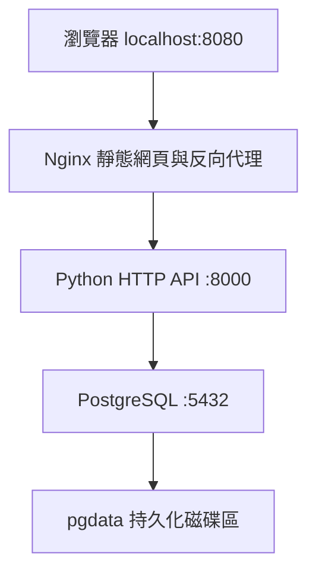

# HW6：Docker 使用 — UniMate 課業任務管理系統

**學號：** 111210552  
**姓名：** 林小蓮  
**班級：** 資工四

## 專案介紹

UniMate 是一個簡單的課業任務管理系統，提供新增任務、標記完成、刪除任務，以及全部／待完成／已完成篩選。前端以 HTML、CSS、JavaScript 製作，後端使用 Python，任務資料儲存在 PostgreSQL。

本作業將不同職責拆分為三個服務，由 Docker Compose 統一管理；屬於簡單的多容器分層架構，並未將每個業務功能拆成獨立微服務。

## 系統架構



| 服務 | 用途 | 設定 |
| --- | --- | --- |
| nginx | 提供網頁，將 /api/ 請求轉送至 api | nginx/default.conf |
| api | 驗證資料、處理任務的新增／查詢／修改／刪除 | Dockerfile、app/server.py |
| db | 儲存任務資料 | docker-compose.yml |

只有 Nginx 對本機開放 8080 連接埠。API 與資料庫透過 Compose 內部網路溝通，不對主機公開連接埠。此專案為本機課堂展示，沒有帳號權限機制；Compose 中的密碼為展示用途，不應直接部署至公開網路。

## 執行環境與啟動

需要 Docker Desktop（包含 Docker Compose）。Windows 請使用 Linux containers，並先啟動 Docker Desktop。

1. 解壓縮，使用終端機進入含有 `docker-compose.yml` 的 `HW6` 資料夾。
2. 確認環境：

```sh
docker --version
docker compose version
```

3. 建置並啟動：

```sh
docker compose up -d --build
```

首次啟動需要下載映像與 Python 套件，必須有網路連線。

4. 查看狀態：

```sh
docker compose ps
```

5. 在瀏覽器開啟 **http://localhost:8080**。

## 操作流程

1. 輸入任務名稱與選填的課程名稱，按「新增任務」。
2. 勾選核取方塊，將任務標記為完成；取消勾選可改回待完成。
3. 使用「全部／待完成／已完成」切換顯示內容。
4. 按「刪除」並確認，即可移除任務。
5. 重新整理頁面後，任務會從 PostgreSQL 重新載入。

網頁左下角顯示 API 與資料庫的初次連線檢查結果，並非持續監測儀表板。

## Docker 學習筆記與建置流程

### 映像與容器

映像（Image）是執行環境的模板；容器（Container）是由映像啟動的執行實例。此系統使用官方 Nginx 與 PostgreSQL 映像，並透過 Dockerfile 建置 Python API 映像。

### Dockerfile

以 `python:3.12-slim` 為基底，設定 `/app` 工作目錄，先複製依賴清單並安裝 psycopg，再複製 API 程式。先處理依賴清單有助於重複建置時使用快取。容器使用非 root 的 `nobody` 執行 Python。

### Docker Compose 與網路

Compose 在一份 YAML 中描述三個服務。容器可透過服務名稱尋找彼此，例如 Nginx 連線到 `api:8000`，Python 透過 `PGHOST=db` 尋找資料庫。容器中的 `localhost` 指向該容器自身，不能用來指向另一個容器。

### 啟動順序與健康檢查

資料庫先通過 `pg_isready`，API 才啟動並建立資料表。API 的 `/api/health` 會查詢資料庫；API 健康檢查成功後，Nginx 才啟動。這能降低容器已啟動但依賴服務尚未就緒的問題。

### 持久化資料

PostgreSQL 將資料儲存在具名磁碟區 `pgdata`，因此 `docker compose down` 後再次啟動仍可保留任務。網頁與 Nginx 設定使用唯讀掛載。

### API 與資料驗證

API 使用參數化 SQL，避免把使用者輸入直接拼接至查詢。任務名稱限 1–120 字，課程名稱最多 60 字。前端使用 `textContent` 呈現任務名稱，避免將輸入當成 HTML 執行。

## API

| 方法 | 路徑 | 功能 |
| --- | --- | --- |
| GET | /api/health | 檢查 API 與資料庫連線 |
| GET | /api/tasks | 取得任務 |
| POST | /api/tasks | 新增任務，JSON：`{"title":"完成 HW6","course":"現代軟體工程"}` |
| PATCH | /api/tasks/1 | 修改完成狀態，JSON：`{"done":true}` |
| DELETE | /api/tasks/1 | 刪除任務 |

## 驗證方式與紀錄

交付前已通過 Python 與 JavaScript 語法檢查。製作環境沒有 Docker，因此尚未完成三個容器的實際整合測試；以下為本機驗證步驟，不代表已執行的結果。

啟動系統後，可執行附帶的自動驗證程式（需本機 Python）：

```sh
python smoke_test.py
```

程式會經由 Nginx 檢查健康狀態、新增測試任務、查詢、標記完成、刪除，以及空白任務驗證，並清理自己建立的測試資料。

持久化需另行驗證：新增一筆任務，執行 `docker compose down`，再執行 `docker compose up -d`，重新整理網頁，確認任務仍存在。

建議實際執行後，補上以下截圖作為實作紀錄：

- `docker compose ps` 顯示三個服務。
- 網頁新增任務與標記完成的畫面。
- 重啟後任務仍保留的畫面。

## 常用指令

```sh
# 查看執行紀錄
docker compose logs --tail=100
# 停止並移除容器，保留資料
docker compose down
# 修改 Python 程式後重新建置
docker compose up -d --build
```

`docker compose down -v` 會連同磁碟區一起刪除，造成任務資料遺失，只有確定要重置資料庫時才使用。

## 常見問題

- **無法連線 Docker daemon：** 確認 Docker Desktop 已啟動。
- **8080 被占用：** 將 Compose 中的 `127.0.0.1:8080:80` 改成 `127.0.0.1:8081:80`，重新執行 Compose，改開 localhost:8081；測試時使用 `python smoke_test.py http://localhost:8081`。
- **網頁無法取得任務：** 查看 `docker compose ps` 和 `docker compose logs api db`。
- **修改資料庫環境變數後出錯：** 舊磁碟區保留原先的帳密；應使用原設定，或在確定不需要資料後重置磁碟區。
- **GitHub Pages：** 僅能提供靜態檔案，無法執行這份 Docker 系統；請按上述方式在本機展示。

## 檔案內容

| 路徑 | 內容 |
| --- | --- |
| Dockerfile | API 映像建置步驟 |
| docker-compose.yml | 三個服務、健康檢查、網路與資料磁碟區 |
| app/server.py | Python HTTP API 與建表程式 |
| app/requirements.txt | Python 依賴 |
| nginx/default.conf | 網頁與反向代理設定 |
| web/ | 網頁、樣式、前端互動 |
| smoke_test.py | 經由 Nginx 的整合驗證程式 |
| MULAI_DI_SINI.txt | 印尼文快速啟動說明 |
