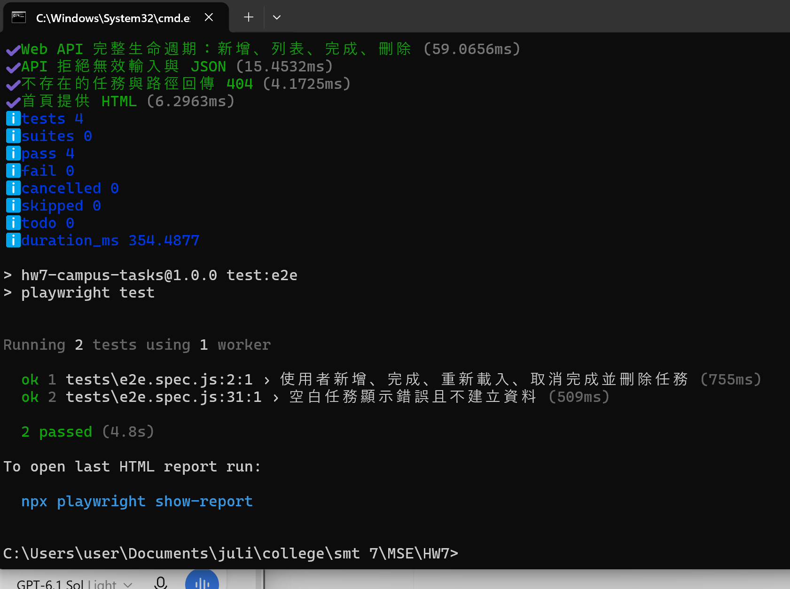
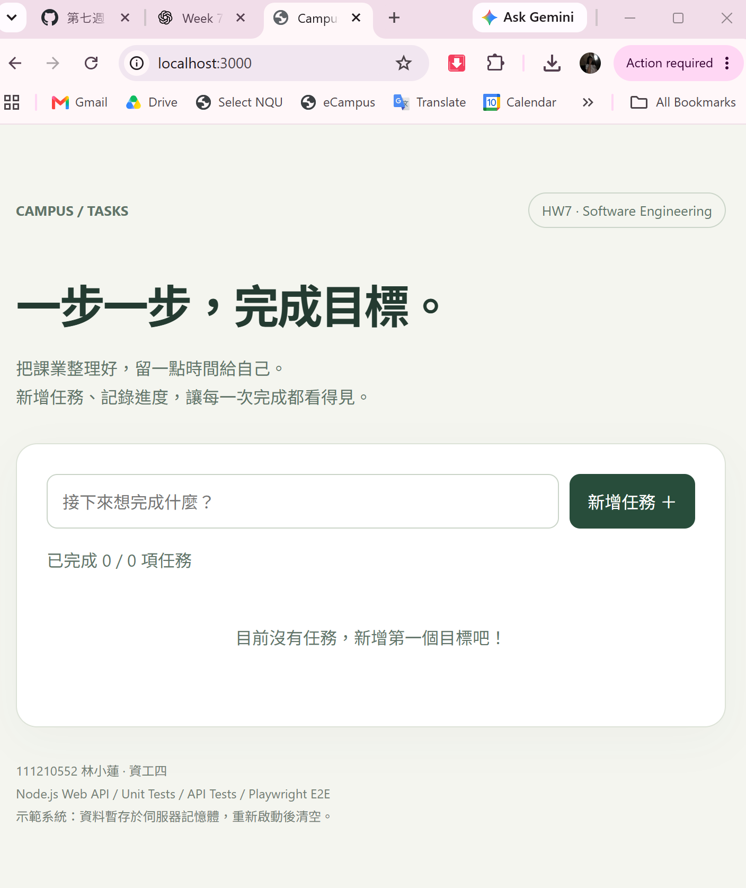

# HW7：網站應用與三種測試

學號：111210552 ｜ 姓名：林小蓮 ｜ 班級：資工四

Campus Tasks 是課業任務管理網站，提供新增、完成／取消完成、刪除任務功能。前端透過 fetch 呼叫 Node.js HTTP API；資料存放於伺服器記憶體，重新啟動後清空。重新整理網頁不會清空資料。同一伺服器的使用者共用任務，僅供課堂示範。

## 執行環境與啟動

安裝 Node.js 22 或以上版本，在本專案資料夾開啟終端機：

```sh
npm ci
npx playwright install chromium
npm start
```

開啟 http://localhost:3000 。停止伺服器請按 Ctrl+C。

## 三種測試

| 類型 | 指令 | 驗證內容 |
| --- | --- | --- |
| 單元測試（server） | `npm run test:unit` | TaskStore 新增、驗證、狀態更新、刪除、資料隔離 |
| 系統測試（Web API） | `npm run test:api` | 實際啟動 HTTP server，測試 CRUD、狀態碼、錯誤輸入與首頁 |
| E2E（Playwright） | `npm run test:e2e` | Chromium headless 操作網頁，新增、完成、重整、取消完成、刪除及驗證錯誤 |

一次執行全部：

```sh
npm test
```

E2E 會自動啟動並關閉測試用伺服器；執行前請先停止手動啟動的 3000 port 伺服器。檢視 HTML 報告：`npx playwright show-report`。

## 測試結果與執行證明

測試日期：2026 年 10 月 23 日。

| 作業要求 | 測試檔案 | 結果 |
| --- | --- | --- |
| 伺服器單元測試 | `tests/unit.test.js` | 5 項通過，0 項失敗 |
| 系統測試（Web API） | `tests/api.test.js` | 4 項通過，0 項失敗 |
| E2E 測試（無頭瀏覽器、Playwright） | `tests/e2e.spec.js` | 2 項通過，0 項失敗 |

三種測試合計 11 項通過。完整執行文字紀錄見 [TEST_RESULTS.txt](TEST_RESULTS.txt)（開發環境：Linux、Node.js v24.19.0）。另外已在 Windows 本機執行 `npm test`；下圖顯示 API 測試 4 項通過，以及 Playwright E2E 測試 2 項通過。截圖未涵蓋上方的單元測試輸出，單元測試細節可參閱文字紀錄與測試程式。

### 系統測試與 E2E 測試畫面



### 網站啟動畫面

使用 `npm start` 啟動伺服器，並以瀏覽器開啟 `http://localhost:3000`，確認網站首頁與任務輸入介面可正常顯示。此畫面為介面展示；自動化功能驗證由上述測試執行。



## API

| 方法 | 路徑 | 輸入／用途 |
| --- | --- | --- |
| GET | /api/tasks | 取得任務 |
| POST | /api/tasks | `{"title":"讀書"}` 新增任務 |
| PATCH | /api/tasks/:id | `{"completed":true}` 更新狀態 |
| DELETE | /api/tasks/:id | 刪除任務 |

新增成功回傳 201；驗證失敗回傳 400；找不到資源回傳 404。

## 檔案結構

- `server.js`：HTTP server 與 API
- `tasks.js`：伺服器任務邏輯
- `public/index.html`：網站介面
- `tests/unit.test.js`：單元測試
- `tests/api.test.js`：系統測試
- `tests/e2e.spec.js`：瀏覽器端到端測試
- `playwright.config.js`：無頭瀏覽器設定
- `TEST_RESULTS.txt`：本次實際測試紀錄

本專案需要 Node.js 後端，GitHub Pages 無法執行完整 API。
